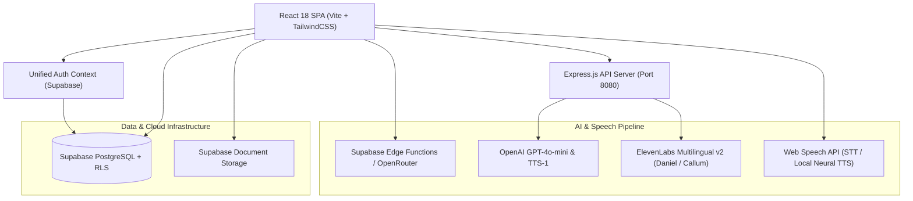

<div align="center">

# ⚖️ NyayaPath (न्यायपथ)
### *Next-Generation AI Legal Intelligence & Citizen Empowerment Platform*

[](https://react.dev/)
[](https://www.typescriptlang.org/)
[](https://tailwindcss.com/)
[](https://supabase.com/)
[](https://elevenlabs.io/)
[](https://openai.com/)

<p align="center">
  <b>Justice. Transparency. Trust.</b><br>
  Bridging the chasm between complex Indian Law and 1.4 billion citizens through real-time voice intelligence, legal notice demystification, statutory rights clarity, and verified advocate matching.
</p>

[Explore Tools](#-flagship-capabilities) • [Architecture](#-system-architecture) • [Getting Started](#-getting-started) • [Tech Stack](#-tech-stack) • [Disclaimer](#-legal-disclaimer)

---

</div>

## 🌟 The Vision

In India, navigating the legal ecosystem is often intimidating, expensive, and shrouded in dense colonial-era legalese. Common citizens frequently face ungrounded legal notices, unfair employer bonds, delayed security deposits, or police confrontation without knowing their statutory rights under the new **Bharatiya Nyaya Sanhita (BNS 2023)** and Constitution.

**NyayaPath** is engineered to democratize access to justice. It provides instant, plain-language legal clarity, voice-driven advocate advisory in **English, Hindi & Hinglish**, automated defensive reply generation, and a direct pipeline to verified Bar Council advocates.

---

## 🚀 Flagship Capabilities

### 🎙️ 1. NyayaVoice — Live AI Virtual Advocate
*Speak your legal dilemma in your native tongue; receive actionable advocate counsel.*
- **Multimodal Voice Engine**: Real-time speech recognition and lifelike studio speech synthesis powered by **ElevenLabs AI Multilingual v2** (featuring *Daniel*, an authoritative senior advocate persona) and **OpenAI Neural TTS**.
- **Bilingual & Hinglish Support**: Native fluency in English, हिन्दी, and conversational Hinglish.
- **Legal Phonetic Engine**: Proprietary pronunciation normalizer that expands abbreviations and currency (`₹60,000` $\rightarrow$ *"60 thousand rupees"*, `Sec. 138` $\rightarrow$ *"Section 138"*, `NI Act` $\rightarrow$ *"Negotiable Instruments Act"*, `BNS` $\rightarrow$ *"Bharatiya Nyaya Sanhita"*).
- **Structured Advocate Strategy**: Delivers immediate legal standing, statutory sections, 3 immediate action steps, and pre-litigation recommendations.

---

### 📄 2. AI Legal Notice & Court Summons Demystifier
*Decode terrifying legal demands, expose empty bluff tactics, and respond with advocate precision.*
- **Threat Assessment Gauge**: Categorizes notices into 🟢 Low (Empty Bluff), 🟡 Medium (Action Advised), 🟠 High, or 🔴 Critical (Statutory clock ticking).
- **Statutory Response Countdown**: Precise calculation of mandatory response windows (e.g., 15 days under Section 138 NI Act, 60 days under SARFAESI).
- **Bluff vs. Law Analyzer**: Differentiates enforceable legal rights from intimidation bluffs (e.g., post-employment non-compete clauses void under **Section 27 of Indian Contract Act**).
- **1-Click Advocate-Grade Reply**: Automatically drafts a formal legal response complete with *"WITHOUT PREJUDICE"* headers, preliminary objections, and factual rebuttals.
- **Instant PDF Export**: Single-click PDF generation via `jsPDF` formatted for Registered Post A/D dispatch.

---

### 🛡️ 3. Police & Citizen Rights Interactive Guide
*Real-time legal defense in your pocket during police encounters, searches, and traffic stops.*
- **Search & Seizure Protections**: Clear rules under **Section 100 CrPC / Section 103 BNSS** (mandatory independent witnesses, woman constable requirements).
- **Arrest Safeguards & D.K. Basu Guidelines**: Statutory limits on arrests without warrants under **Section 35 BNSS** (crimes with $<7$ years imprisonment require notice of appearance first).
- **Women's Night Arrest Immunity**: Strict statutory bar under **Section 43(5) BNSS** against arresting women between sunset and sunrise without Magistrate permission.
- **Digital Privacy**: Clarifies why police cannot confiscate or inspect personal WhatsApp messages or smartphones without an explicit court warrant.

---

### ⚖️ 4. Bail & Offence Checker (IPC $\leftrightarrow$ BNS Converter)
*Search any offence to determine bailable status, jail terms, and newly restructured criminal sections.*
- **IPC to BNS 2023 Cross-Mapping**: Instant translation between old Indian Penal Code sections and modern Bharatiya Nyaya Sanhita codes (e.g., Cheating: IPC 420 $\leftrightarrow$ BNS 318(4); Murder: IPC 302 $\leftrightarrow$ BNS 103).
- **Arrest Power & Bail Status**: Clear badges for **Bailable vs Non-Bailable** and **Cognizable vs Non-Cognizable**.
- **Compounding Eligibility**: Identifies whether the dispute can be amicably settled out of court.

---

### 💼 5. Complete Legal Suite for Citizens & Lawyers
| Feature | Description |
| :--- | :--- |
| **🔍 Supreme Court Case Search** | Search through landmark judgments and extract *ratio decidendi* in plain English. |
| **📑 Notice Generator** | Interactive wizard to generate formal legal notices for unpaid dues, tenancy, or consumer grievances. |
| **🗺️ Strategy Planner** | Step-by-step litigation roadmap detailing timelines, forms, and procedural milestones. |
| **💰 Cost Estimator** | Transparent court fee calculators and realistic advocate fee bands across Indian states. |
| **💬 Lawyer Chat & Inbox** | Real-time consultation portal connecting citizens with verified Bar Council advocates. |
| **📰 Live Court News** | Real-time legal journalism and updates directly from the Supreme Court and High Courts. |

---

## 🏗️ System Architecture



---

## 🛠️ Tech Stack

### Frontend
- **Framework**: [React 18](https://react.dev/) + [Vite](https://vitejs.dev/) (Single-Page Application)
- **Routing**: [React Router 6](https://reactrouter.com/) (Declarative Client-side SPA routing)
- **Styling**: [Tailwind CSS 3](https://tailwindcss.com/) + Custom Glassmorphic Dark/Light Theming
- **UI Components**: [Radix UI](https://www.radix-ui.com/), [Lucide React Icons](https://lucide.dev/), [Framer Motion](https://www.framer.com/motion/)
- **Document & PDF**: [jsPDF](https://github.com/parallax/jsPDF) for client-side legal document generation

### Backend & Cloud
- **Server**: [Express.js](https://expressjs.com/) with TypeScript
- **Database & Auth**: [Supabase](https://supabase.com/) (PostgreSQL with Row Level Security, Realtime Subscriptions, JWT Auth)
- **Edge Compute**: Supabase Deno Edge Functions
- **AI Models**: OpenAI GPT-4o-mini, OpenRouter API
- **Voice Intelligence**: ElevenLabs API (Multilingual v2), Web Speech API

---

## 📂 Project Structure

```
├── client/                     # Frontend React Application
│   ├── components/             # Reusable UI & Layout Components
│   │   └── ui/                 # Radix UI primitives, Navbar, Badges, Toasters
│   ├── context/                # Global Application State
│   │   └── AuthContext.tsx     # Unified Supabase Auth Provider & Session Listener
│   ├── lib/                    # Client Libraries
│   │   └── supabaseClient.ts   # Configured Supabase Browser Client
│   ├── pages/                  # Page Route Views
│   │   ├── NyayaVoice.tsx      # 🎙️ Live Voice Advocate (ElevenLabs + Web Speech)
│   │   ├── NoticeDemystifier.tsx# 📄 Legal Notice Demystifier & PDF Generator
│   │   ├── CitizenRights.tsx   # 🛡️ Police & Citizen Rights Interactive Guide
│   │   ├── BailChecker.tsx     # ⚖️ Bail & Offence Checker (IPC ↔ BNS 2023)
│   │   ├── MyQuestion.tsx      # Verified Citizen Legal Query Dashboard
│   │   ├── AskQuestion.tsx     # Case Inquiry & Document Submission
│   │   ├── CaseStrategyPlanner.tsx # Litigation Roadmap Planner
│   │   ├── LegalNoticeGenerator.tsx# Notice Drafter
│   │   └── LawyerDirectory.tsx # Verified Advocate Finder
│   ├── App.tsx                 # App Root & Client Route Registry
│   └── global.css              # Tailwind Directives & Global Theme Tokens
│
├── server/                     # Backend Express Integration
│   ├── routes/                 # API Endpoints
│   │   ├── tts.ts              # ElevenLabs & OpenAI Speech Synthesis Handlers
│   │   ├── legal-notice.ts     # Document Generation Handlers
│   │   └── demo.ts             # Healthcheck Endpoints
│   └── index.ts                # Express App Configuration & Route Registration
│
├── supabase/                   # Supabase Configuration
│   ├── functions/              # Edge Functions
│   │   └── openrouter-chat/    # AI Chat Edge Function
│   └── schema.sql              # Database Tables, RLS Policies, & Indexes
│
└── package.json                # Project Dependencies & Scripts
```

---

## ⚡ Getting Started

### Prerequisites
- **Node.js**: v18.0.0 or higher
- **PNPM**: v9 or v10 (Recommended) or NPM

### 1. Clone the Repository
```bash
git clone https://github.com/your-username/nyayapath.git
cd nyayapath
```

### 2. Install Dependencies
```bash
pnpm install
```

### 3. Configure Environment Variables
Create a `.env.local` file in the root directory:

```env
# Supabase Configuration
VITE_SUPABASE_URL="https://your-supabase-project.supabase.co"
VITE_SUPABASE_ANON_KEY="your-supabase-anon-key"
VITE_OPENROUTER_FUNCTION_URL="https://your-supabase-project.supabase.co/functions/v1/openrouter-chat"

# Voice & AI Speech Synthesis (Optional, enables studio-grade AI voices)
ELEVENLABS_API_KEY="your-elevenlabs-api-key"
OPENAI_API_KEY="your-openai-api-key"
```

### 4. Start the Development Server
```bash
pnpm dev
```
The application will launch at **`http://localhost:8080`** with Vite Hot Module Replacement (HMR).

### 5. Typecheck & Build
```bash
# Validate TypeScript with 0 compilation errors
pnpm typecheck

# Build client and server for production
pnpm build
```

---

## 🔒 Security & Privacy

- **Row Level Security (RLS)**: User legal queries and private case documents are locked to their authenticated `user_id`.
- **Zero-Log Notice Analysis**: Pasted notice text in the *Notice Demystifier* is processed ephemeral in-memory without persistent database storage.
- **Client-Side Speech Processing**: Web Speech STT and browser TTS run on-device without recording or caching audio.

---

## ⚖️ Legal Disclaimer

> **IMPORTANT NOTICE:**  
> NyayaPath is an educational and legal information platform powered by artificial intelligence. It does **not** constitute formal legal representation or an advocate-client relationship under the *Advocates Act, 1961*. Users should always consult a licensed Bar Council advocate for representation before courts or tribunals.

---

<div align="center">
  <sub>Built with ❤️ for Citizen Empowerment & Access to Justice in India.</sub>
</div>
